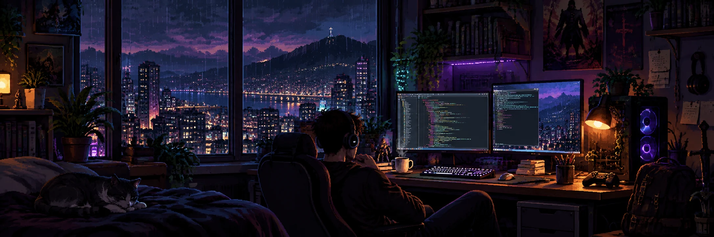

<div align="center">
  

  <h1>Felipe Delson <sub>🌙</sub></h1>
  <p><strong>Desenvolvedor em formação • ADS • Front-end &amp; Back-end</strong></p>
  <p><code>usuario@frevo:~$ ./build-my-future.sh</code></p>
  <p>
    <a href="https://github.com/Frevonarkia?tab=repositories"></a>
    <a href="https://github.com/Frevonarkia"></a>
  </p>
</div>

---


```console

nome        : Felipe Delson
formacao    : Análise e Desenvolvimento de Sistemas (em andamento)
foco        : Desenvolvimento web, do front-end ao back-end
mentalidade : Entender como funciona, não apenas fazer funcionar
ambiente    : Debian x Windows • VS Code • terminal • lo-fi
status      : Aprendendo, experimentando e construindo
```

Estou construindo minha base em programação com **projetos reais, estudos e muita prática**. Meu foco atual é aprofundar **JavaScript, PHP e MySQL**, sem deixar de melhorar HTML e CSS.


<div align="center">
  
</div>

<sub>Essas são tecnologias que utilizo e estudo. Estou em evolução, não me apresento como especialista nelas.</sub>


<div align="center">
  
  <p><code>OS: Debian</code> · <code>Editor: VS Code</code> · <code>Versionamento: Git/GitHub</code></p>
</div>


| Projeto | Descrição | Acesso |
| :--- | :--- | :--- |
| 🏡 **VerdeLar Imóveis** | Interface web responsiva, navegação, layout e acessibilidade. | *Repositório público não localizado neste perfil* |
| 🥐 **Forninho do Rio** | Cardápio digital com HTML, CSS e interações em JavaScript. | *Repositório público não localizado neste perfil* |
| 🐍 **Conversor de imagens** | Projeto em Python para converter imagens em PDF. | [Ver repositório](https://github.com/Frevonarkia/conversor) |
| 📚 **Meus Estudos** | Espaço reservado para estudos e práticas. | [Ver repositório](https://github.com/Frevonarkia/MeusEstudos) |

> Projetos em evolução. Vou publicar e documentar novas versões conforme avanço nos estudos.


```text
[✓] HTML e CSS: fundamentos e páginas responsivas
[~] JavaScript: lógica, DOM e interatividade
[~] PHP + MySQL: back-end e banco de dados
[ ] Aplicações full-stack com autenticação e CRUD
[ ] Testes, boas práticas e deploy
[ ] Desenvolvimento mobile
```

<sub>✓ já praticado · ~ estudando e aprofundando · □ próximo objetivo</sub>


<div align="center">
  
  
</div>

<sub>Os cartões acima dependem de um serviço externo e podem não carregar em alguns momentos. As linguagens refletem repositórios públicos, não o nível de domínio.</sub>


<div align="center">
  <a href="https://github.com/Frevonarkia"></a>
  <a href="https://github.com/Frevonarkia?tab=repositories"></a>
</div>

---

<div align="center">
  <samp>felipe@frevo:~$ echo "Um commit de cada vez."</samp>
  <p><sub>☕ código, curiosidade, chuva e lo-fi | <strong>still building...</strong></sub></p>
</div>
